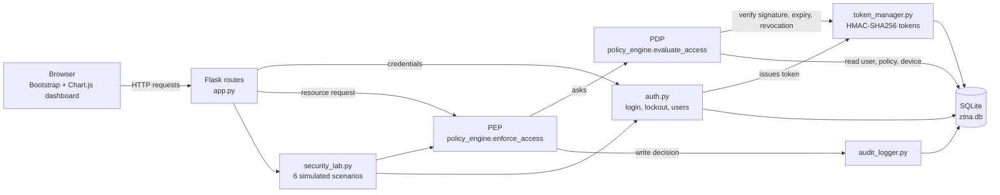
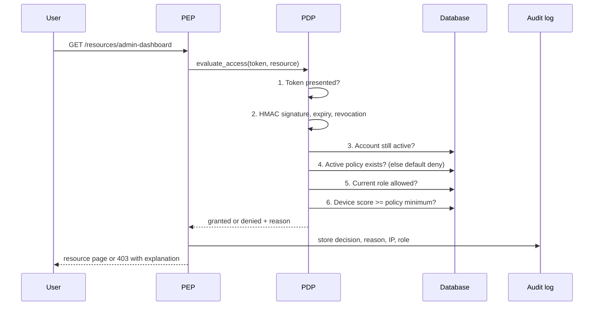

# Mini Zero Trust Network Access (ZTNA) Gateway

**Identity-Based Authentication and Policy-Driven Resource Access Control**

A working Zero Trust prototype built with Python, Flask and SQLite. Logging in is not enough:
**every request** to a protected resource is re-evaluated against identity, token, role, policy
and device security posture. Every decision is explained and recorded in an audit log.

> Academic prototype for learning and demonstration. It is **not** an enterprise ZTNA product.

Author: Utkarsh Gangwar, M.Tech Information Security and Cyber Forensics

---

## 1. Problem statement

Traditional perimeter security trusts anyone who is "inside the network" or who has logged in once.
A stolen password, a hijacked session, a user with excessive privileges, or an infected laptop
then gets broad access. Zero Trust replaces implicit trust with continuous verification:

> **Never trust automatically, always verify.**

## 2. Objectives

- Authenticate users securely (salted password hashes, lockout, generic error messages).
- Issue signed, expiring, revocable access tokens using standard HMAC-SHA256.
- Separate the **Policy Decision Point (PDP)** from the **Policy Enforcement Point (PEP)**.
- Enforce role-based, resource-level policies with **default deny**.
- Evaluate a simulated device security posture on every request.
- Record every decision with a clear reason, and let administrators search and filter the logs.
- Demonstrate attacks safely through a built-in Security Testing Lab.

## 3. Architecture



### Request flow for a protected resource



### How the modules interact

| Module | Responsibility |
|---|---|
| `config.py` | Keys, token lifetime, lockout limits, posture weights |
| `database.py` | SQLite schema, parameterised query helpers, demo data |
| `token_manager.py` | Create and verify HMAC-SHA256 tokens, revoke tokens |
| `auth.py` | Password verification, lockout, user management |
| `policy_engine.py` | **PDP** (`evaluate_access`) and **PEP** (`enforce_access`), policy and device management |
| `audit_logger.py` | Write and search access logs and security events, dashboard statistics |
| `security_lab.py` | Six local attack simulations run through the real engine |
| `app.py` | Flask routes, page guard, CSRF, JSON APIs |

## 4. Technology stack

Python 3.10+, Flask, SQLite, HTML5, CSS3, JavaScript, Bootstrap 5, Chart.js, Lucide icons,
Werkzeug password hashing, Python `hmac` / `hashlib` / `secrets`. No React, Node.js or Docker.

## 5. Features

- Login and logout with role-based accounts (Admin, Security Analyst, Normal User)
- Zero Trust policy engine with six ordered checks and understandable denial reasons
- Resource-level policies (allowed roles, minimum device score, active or inactive)
- Simulated device posture (OS patched, antivirus, disk encryption, firewall) with live scoring
- Protected resources: Admin Dashboard, Security Reports, General Documents
- Audit logs with search, filters (decision, role, resource, date range) and CSV export
- Dashboard: users, active sessions, requests, granted vs denied, activity chart, device trust, recent events
- Security Testing Lab with six scenarios
- User management, policy management, device management and system settings, all working

## 6. Security mechanisms

| Mechanism | How it is implemented |
|---|---|
| Password storage | Werkzeug salted hashes, never plain text |
| Brute-force defence | Failed-login counter, temporary account lockout, generic error message |
| Access tokens | `payload.signature`, signature = HMAC-SHA256 over the payload |
| Token integrity | Constant-time comparison with `hmac.compare_digest`; signature checked before the payload is trusted |
| Token expiry and revocation | `exp` claim plus a server-side token table (logout revokes the token) |
| Live authorization | Role and device score are read from the database on every request, not from the token |
| Default deny | No active policy means no access |
| CSRF protection | Per-session token required on every POST |
| Session safety | HttpOnly and SameSite cookies, session reset at login, logout is a POST |
| Injection defence | Parameterised SQL everywhere; templates auto-escape; JavaScript uses `textContent` |
| CSV injection | Cells beginning with `= + - @` are neutralised on export |
| Safe errors | Generic error pages; no stack traces shown to users |

No custom cryptography is used: only standard primitives, used as intended.

## 7. Installation (Windows)

Requirements: Python 3.10 or newer, and an internet connection (Bootstrap, Chart.js and Lucide
load from a CDN).

```
cd C:\path\to\ztna_gateway

python -m venv venv
venv\Scripts\activate
pip install -r requirements.txt

python database.py --reset
python app.py
```

Open **http://127.0.0.1:5000**. The database is created and seeded automatically on first run;
`python database.py --reset` rebuilds it from scratch. Stop the server with `Ctrl + C`.

Next time: `cd` into the folder, run `venv\Scripts\activate`, then `python app.py`.

## 8. Demo credentials (development only)

| Role | Username | Password |
|---|---|---|
| Administrator | `admin` | `Admin@12345` |
| Security Analyst | `analyst` | `Analyst@12345` |
| Normal User | `user` | `User@12345` |

At login you also choose a **simulated device**:

| Device | Score | Trust level |
|---|---|---|
| Corporate Laptop | 100 | Trusted |
| Personal Tablet | 55 | At risk |
| Unknown Device | 20 | Untrusted |

Default policies: Admin Dashboard (admin only, device score 80+), Security Reports
(admin and analyst, 70+), General Documents (everyone, 50+).

## 8a. Page access by role

| Page | Admin | Analyst | User |
|---|---|---|---|
| Dashboard, Audit Logs, Security Lab | yes | yes | no |
| Security Policies, Device Posture (view) | yes | yes | no |
| Users, Settings, and changing policies or devices | yes | no | no |
| Access Requests (own history for Normal User) | yes | yes | yes |

## 9. Testing scenarios

**Security Testing Lab** (Security Lab page, "Run all 6 scenarios"):

1. Normal authorized access: granted
2. Unauthorized role opening an admin resource: denied (role)
3. Untrusted device: denied (device posture)
4. Expired token: denied
5. Modified (tampered) token: denied (signature mismatch)
6. Invalid login attempts: rejected with a generic message

**Automated tests** (40 cases, using a temporary database, so your data is safe):

```
python -m pytest -v
```

They cover valid and invalid login, lockout, password hashing, valid, expired, modified and
revoked tokens, unauthorized resource access, a 9-case role matrix, device posture rejection,
default deny, live role and posture changes, audit logging, the Security Lab, CSRF, logout
and page guards.

## 10. Suggested live demonstration

1. Log in as `admin` on the Corporate Laptop and open the dashboard.
2. Run **all six** Security Lab scenarios and watch the counters and charts change.
3. Open Audit Logs, filter by Denied, and export the CSV.
4. On Device Posture, switch off a control on the laptop, then request the Admin Dashboard
   again: the next request is denied for low device trust.
5. On User Management, change a role and show it applies on the next request.
6. Log in as `user` and show the denied Admin Dashboard with the check-by-check explanation.

## 11. Limitations

- Prototype only: single user at a time, Flask development server, SQLite.
- Device posture is **simulated**; a real system receives it from an endpoint agent.
- Served over plain HTTP on localhost, so cookies are not marked `Secure`.
- No per-IP rate limiting (only per-account lockout) and no Content-Security-Policy header.
- No multi-factor authentication or password reset.
- Development-only secret keys by default (override with `ZTNA_FLASK_SECRET` and `ZTNA_TOKEN_SECRET`).
- The "Default minimum posture score" setting is stored but not used; each policy has its own minimum.
- Front-end libraries load from a CDN, so an internet connection is needed.

## 12. Future enhancements

Multi-factor authentication, an endpoint agent for real posture data, per-IP rate limiting,
Content-Security-Policy and HTTPS, short-lived tokens with refresh tokens, geo and time-based
policies, risk scoring from behaviour, a production WSGI server with PostgreSQL, tamper-evident
(hash-chained) audit logs, and integration with an identity provider (OIDC/SAML).

## 13. Project structure

```
ztna_gateway/
├── app.py  config.py  database.py  auth.py  policy_engine.py
├── token_manager.py  audit_logger.py  security_lab.py
├── requirements.txt  README.md
├── templates/   (12 pages: base, login, dashboard, users, access_requests, policies,
│                 devices, audit_logs, security_lab, settings, resource_view, denied)
├── static/css/style.css
├── static/js/   (app.js, dashboard.js, admin-pages.js)
└── tests/       (conftest.py, test_ztna.py)
```

## 14. Troubleshooting

| Problem | Fix |
|---|---|
| `python` is not recognised | Reinstall Python with "Add Python to PATH", or use `py` |
| `No module named 'flask'` | Activate the venv, then `pip install -r requirements.txt` |
| `TemplateNotFound` | A file is missing from `templates\` or in the wrong folder |
| Page has no styling or charts | No internet access (CDN), or `static\` files missing; press `Ctrl + F5` |
| `Address already in use` | Another copy is running; close it with `Ctrl + C` |
| `database is locked` | A cloud-sync folder (e.g. OneDrive) is syncing the file; pause sync |